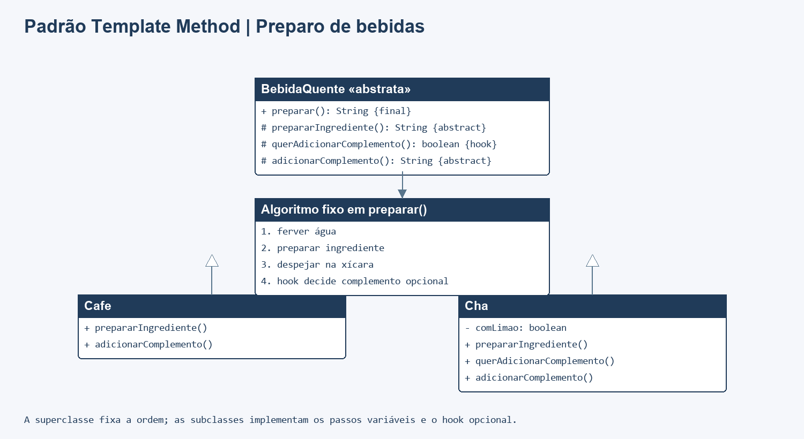

# Padrão Template Method em Java

Aplicação de console que prepara café e chá seguindo uma sequência comum. A classe abstrata define o algoritmo em `preparar()` e deixa que cada bebida implemente seus passos específicos. O método principal é `final`, preservando a ordem do preparo.

## Executar

Requer JDK 8 ou superior, sem dependências externas. Na raiz do repositório:

```sh
mkdir out
javac -encoding UTF-8 -d out src/*.java tests/*.java
java -cp out Main
java -cp out TemplateMethodTest
```

Se `out` já existir, pule o `mkdir`. Os testes usam verificações explícitas e terminam com código de erro quando algo falha.

## Participantes

| Papel | Classe |
| --- | --- |
| Template Method | `BebidaQuente.preparar()` |
| Classe abstrata | `BebidaQuente` |
| Subclasses concretas | `Cafe`, `Cha` |
| Operações primitivas | `prepararIngrediente()`, `adicionarComplemento()` |
| Hook opcional | `querAdicionarComplemento()` |
| Cliente | `Main` |

A sequência fixa é ferver água, preparar o ingrediente, despejar na xícara e, se o hook permitir, adicionar o complemento. Café e chá fornecem os detalhes dos próprios passos.

## Diagrama de classes



Fonte editável: [diagrama.mmd](docs/diagrama.mmd).

## Testes

`tests/TemplateMethodTest.java` verifica os passos específicos, a ordem invariável do algoritmo, o hook opcional do chá e diferenças entre os preparos.
